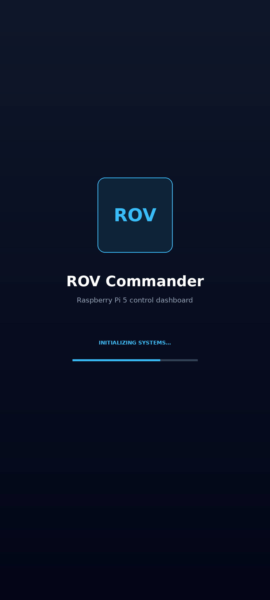
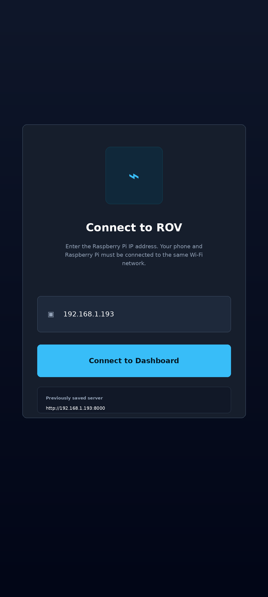
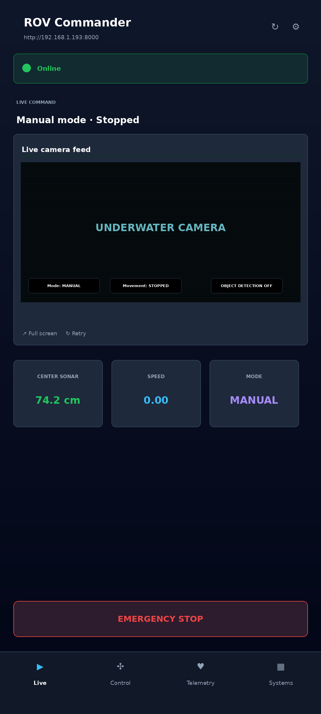
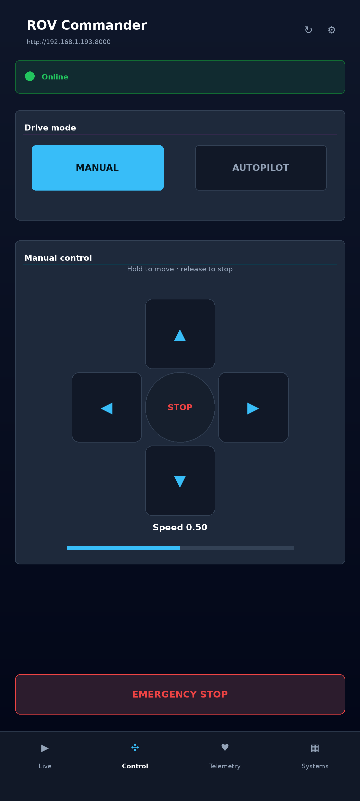
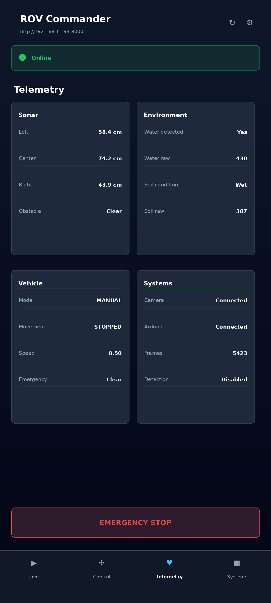
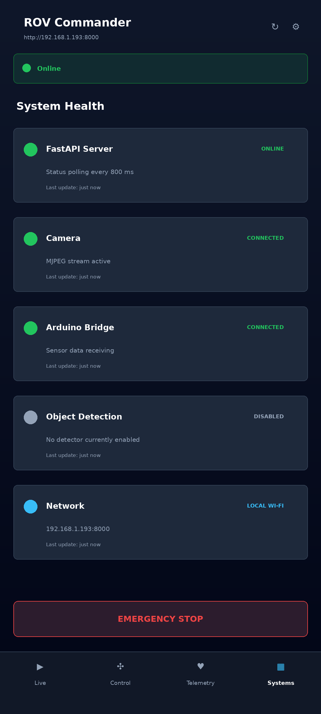
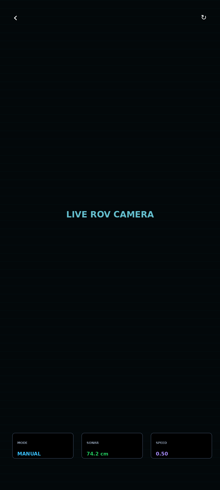
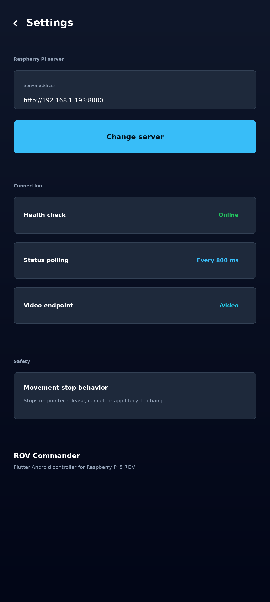
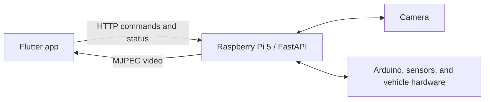

<div align="center">


# ROV Commander

A Flutter operator dashboard for a Raspberry Pi 5 powered ROV.

Watch the camera feed, drive the vehicle, switch operating modes, and monitor telemetry from your phone.

[App previews](#app-previews) · [Getting started](#getting-started) · [API reference](#api-reference) · [Raspberry Pi server](https://github.com/Azrul16/ROV-Commander-RasberryPi5-Server-)

</div>

## App previews

The mockups below show the connection flow, dashboard views, video player, and settings. Open any image to view it at full size.

| Splash | Connection |
| :---: | :---: |
|  |  |
| **Live dashboard** | **Vehicle control** |
|  |  |
| **Telemetry** | **Systems** |
|  |  |
| **Full-screen video** | **Settings** |
|  |  |

## Features

- **Live video:** MJPEG camera streaming with a full-screen view.
- **Manual driving:** press-and-hold directional controls with stop commands on release or cancellation.
- **Operating modes:** switch between manual control and server-managed autopilot.
- **Emergency controls:** send emergency stop and clear commands.
- **Telemetry:** view sonar distances, water and soil readings, vehicle state, and camera and Arduino status.
- **Connection monitoring:** refresh status automatically and display connection errors.
- **Saved setup:** store the Raspberry Pi server address locally for the next launch.
- **Dark dashboard:** Material 3 styling for the operator interface.

## How it works

The Flutter app communicates with the companion [Raspberry Pi 5 FastAPI server](https://github.com/Azrul16/ROV-Commander-RasberryPi5-Server-) over HTTP. The server handles camera streaming, sensors, vehicle commands, and hardware integration.



On first launch, enter the server address. The app saves the normalized URL, opens the dashboard, and starts fetching `/status`. Later launches reuse the saved address. Opening the dashboard does not perform a separate `/health` check.

Status requests do not overlap. After each request finishes, the app schedules the next refresh with an **800 ms delay**.

## Getting started

### Requirements

- A Flutter SDK that includes Dart compatible with `^3.12.1`, as declared in [pubspec.yaml](pubspec.yaml).
- Android Studio or VS Code with Flutter tooling.
- An Android device or emulator with network access to the Raspberry Pi.
- The companion Raspberry Pi server running and reachable, normally on port `8000`.

The repository includes Flutter platform scaffolding for Android, iOS, web, Windows, macOS, and Linux. The setup below targets Android; other platforms may require additional configuration.

### Run the app

```bash
git clone https://github.com/azrul16/ROV-Commander-Flutter-App.git
cd ROV-Commander-Flutter-App
flutter pub get
flutter run
```

Connect the phone and Raspberry Pi to the same local network, then enter the Pi's address in the connection screen:

```text
192.168.1.193
192.168.1.193:8000
http://192.168.1.193:8000
```

The app adds `http://` when no scheme is provided and uses port `8000` when no explicit port is supplied. You can change the saved server through Settings. Android is configured to allow local cleartext HTTP traffic.

### Build an Android APK

```bash
flutter build apk --release
```

Output: `build/app/outputs/flutter-apk/app-release.apk`.

## Controls and connection behavior

Manual controls are enabled when the latest vehicle status reports manual mode, the connection is online, emergency stop is inactive, and no command is being sent.

Pressing a direction sends a movement command with a default speed of `0.5`. Releasing or cancelling the press sends `stop`. The app also attempts a stop when a movement command fails, the connection is lost during movement, or the app becomes inactive, paused, hidden, or detached. Stop requests still depend on the server being reachable.

Autopilot behavior runs on the server. The app switches modes and displays the reported action and reason.

## API reference

All paths are relative to the configured server URL, for example `http://192.168.1.193:8000`.

| Method | Path | Purpose |
| --- | --- | --- |
| `GET` | `/status` | Dashboard telemetry and vehicle state; fetched automatically. |
| `GET` | `/video` | Live MJPEG camera stream. |
| `GET` | `/health` | Health endpoint exposed by the API client; not used for startup validation. |
| `GET` | `/sonar` | Dedicated sonar endpoint exposed by the API client. |
| `GET` | `/environment` | Dedicated environment endpoint exposed by the API client. |
| `POST` | `/control` | Send a movement or stop command. |
| `POST` | `/mode` | Select manual or autopilot mode. |
| `POST` | `/emergency-stop` | Activate emergency stop. |
| `POST` | `/emergency-clear` | Clear emergency stop. |

Example movement request body for `/control`:

```json
{ "command": "forward", "speed": 0.5 }
```

Supported movement commands are `forward`, `backward`, `left`, `right`, and `stop`. Stop requests use a speed of `0`.

Example mode request body for `/mode`:

```json
{ "mode": "autopilot" }
```

Use `manual` to return to manual mode. The `/status` response contains `vehicle`, `sonar`, `arduino`, `camera`, and `server_time` fields. See the [app models](lib/models) for the expected fields and the [server repository](https://github.com/Azrul16/ROV-Commander-RasberryPi5-Server-) for the backend implementation.

## Development

The app uses `bloc` / `flutter_bloc` for state, Dio and Retrofit for HTTP requests, SharedPreferences for the saved address, `connectivity_plus` for network changes, and `flutter_mjpeg` for video.

```text
lib/
  main.dart        App entry point
  app.dart         Root widget, theme, and startup routing
  blocs/           ROV state, polling, and command handling
  core/            Theme, constants, and URL normalization
  models/          Vehicle, sensor, camera, and health models
  screens/         Connection, dashboard, video, settings, and splash
  services/        API client and local storage
  widgets/         Reusable dashboard and control components
mockups/           App preview images used in this README
test/              Automated tests
```

| Task | Command |
| --- | --- |
| Install dependencies | `flutter pub get` |
| Format Dart files | `dart format lib test` |
| Analyze code | `flutter analyze` |
| Run tests | `flutter test` |
| Regenerate Retrofit client | `dart run build_runner build` |

The generated client is already included. After changing [rov_api_client.dart](lib/services/rov_api_client.dart), regenerate `rov_api_client.g.dart` instead of editing it by hand.

## Troubleshooting

| Issue | What to check |
| --- | --- |
| Cannot connect or status stays offline | Confirm the server address, port, Wi-Fi connection, and firewall settings. Try opening `http://<pi-ip>:8000/status` from the phone's browser. |
| Camera feed is missing | Check that `/video` serves MJPEG and that the server reports the camera as connected. |
| Manual controls are disabled | Check connection status, operating mode, emergency state, and whether a command is still being sent. |
| Generated client errors | Run `flutter pub get`, then `dart run build_runner build`. |

## Contributing

Fork the repository, create a branch, and submit a pull request describing the change and how you verified it. For code changes, run formatting, analysis, and tests before submitting. Regenerate the API client if its interface changes, and verify UI changes on a device or emulator.

## Author and license

Created by **Azrul Amaline** — [azrul.amaline16@gmail.com](mailto:azrul.amaline16@gmail.com).

This repository currently has no license file.
